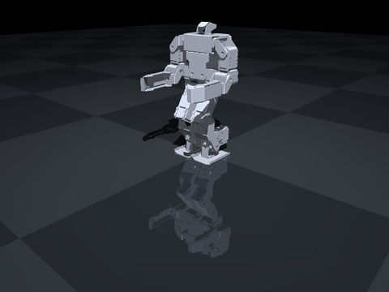
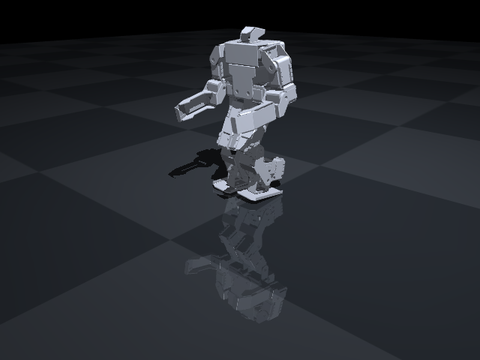
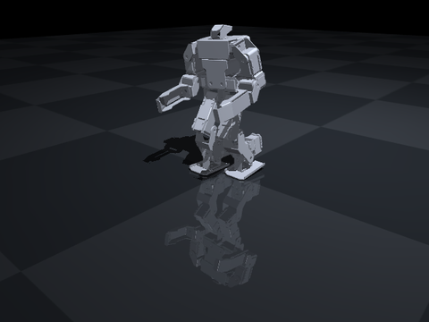

# Bioloid GP MuJoCo simulator

A MuJoCo, Gymnasium, and PPO project containing two models: the user's exact
16-DOF `BioloidGP.stp` assembly and an older simplified 18-DOF learning model.
The exact model is generated only from
`C:\Users\IoT\Desktop\BioloidGP_Step`: all 63 CAD solids are assigned to 17
rigid links around the 16 AX-12 horn frames preserved in the STEP assembly.

## Trained walking demo

The exact STEP-derived robot walks to the 0.5 m goal using the included PPO
policy. This GIF is rendered directly from a deterministic MuJoCo evaluation.


| Start | Mid-step | Goal reached |
| --- | --- | --- |
|  |  |  |

## What works

- exact free-floating humanoid with 3 joints per arm and 5 joints per leg;
- exact CAD link meshes, 16 servo axes, 1.99 kg estimated mass, and contact masks;
- floor collision plus self-collision between non-adjacent robot links;
- joint, velocity, and actuator-force limits;
- a neutral standing controller and interactive MuJoCo viewer;
- a Gymnasium environment with randomized resets and a forward-walking reward;
- PPO training and checkpoint evaluation through Stable-Baselines3.

The included `runs/bioloid_exact_walk_0p5m_v2.zip` policy was trained for
about 1.62 million cumulative simulation steps. In a 20-episode deterministic
evaluation it reached the 0.5 m goal in 20/20 episodes, averaged 0.502 m and
0.187 m/s, and produced no MuJoCo solver warnings.

This is a simulation baseline, not yet a calibrated digital twin. Before a
policy is sent to hardware, actuator latency, backlash, real masses, IMU noise,
joint signs, and the AX-12/AX-18 torque curves must be measured and randomized.

## Windows setup

From PowerShell in this directory:

```powershell
& 'C:\Program Files\FreeCAD 1.1\bin\python.exe' -m venv .venv
.\.venv\Scripts\python.exe -m pip install -e '.[train,test]'
```

## Multi-robot arena

Open the graphical launcher:

```powershell
.\.venv\Scripts\bioloid-arena.exe
```

Choose from 1 to 12 robots, set the visible simulation speed from `0.25×` to
`8×`, configure a 7-second robot lifetime, random physical pushes and automatic fall recovery, and press
**Launch**. The launcher places all robots in one MuJoCo window and controls
them with the included walking policy.

The same settings can be passed directly without the launcher:

```powershell
.\.venv\Scripts\bioloid-arena.exe --robots 6 --speed 4 --lifetime 7 --push-interval 5 --push-force 35 --auto-recover
```

On Windows, `launch_arena.cmd` opens one control center with buttons for the
multi-robot arena and visible AI training. It is used by the single desktop
shortcut named `Bioloid GP`.

`launch_visible_training.cmd` starts visible recovery training with seven-second
lives, 35% fallen starts, and three million additional steps. It resumes from
`runs/bioloid_visible_recovery.zip` when that completed model exists; otherwise
it starts from the included walking policy. Do not start two training copies at
the same time.

Open the model with its neutral pose controller:

```powershell
.\.venv\Scripts\bioloid-view.exe
```

Run the articulated exact 16-DOF model:

```powershell
.\.venv\Scripts\bioloid-view.exe --exact
```

Open the monolithic static CAD assembly exported directly from `BioloidGP.stp`:

```powershell
.\.venv\Scripts\bioloid-view.exe --cad
```

Regenerate the exact mesh from the original STEP folder:

```powershell
& 'C:\Program Files\FreeCAD 1.1\bin\python.exe' tools\export_step_mesh.py `
  'C:\Users\IoT\Desktop\BioloidGP_Step\BioloidGP.stp' `
  src\bioloid_sim\models\bioloid_gp_exact.stl
```

The exact model uses 17 link meshes, 16 servo axes, CAD-derived masses and
inertias, mesh collision hulls, and position actuators. The static CAD preview
keeps all 63 original solids in one visual body for geometry comparison.

Train balance on the exact STEP model:

```powershell
.\.venv\Scripts\bioloid-train.exe --model exact --task balance `
  --steps 100000 --envs 8 --output runs\bioloid_exact_balance
```

Run visible walking and recovery training. One training life lasts 7 seconds
(five seconds shorter than the original 12-second default), collisions stay
enabled, and fallen starts are included automatically:

```powershell
.\.venv\Scripts\bioloid-train.exe --model exact --task walk --render `
  --steps 3000000 --episode-seconds 7 --fallen-reset-prob 0.35 `
  --resume runs\bioloid_exact_walk_0p5m_v2.zip `
  --output runs\bioloid_visible_recovery
```

Visible training intentionally uses one environment so that one MuJoCo window
shows the robot being trained. Use `--no-recover` only when fall recovery is
not part of the task.

Recovery training penalizes every control step spent fallen, applies an
additional `-50` penalty when the seven-second life ends without recovery, and
awards up to `+50` extra for standing up quickly (in addition to the `+25`
recovery reward). Once upright, forward progress continues earning the walking
reward.

Evaluate the exact balance policy:

```powershell
.\.venv\Scripts\bioloid-eval.exe runs\bioloid_exact_balance.zip `
  --model exact --task balance
```

For a repeatable evaluation without a window:

```powershell
.\.venv\Scripts\bioloid-eval.exe runs\bioloid_exact_balance.zip `
  --model exact --task balance --headless --episodes 10
```

Run the included 0.5 m walking policy in real time:

```powershell
.\.venv\Scripts\bioloid-eval.exe runs\bioloid_exact_walk_0p5m_v2.zip `
  --model exact --task walk --goal-distance 0.5
```

Run the hybrid recovery controller. It executes a collision-safe get-up
trajectory and then switches back to the trained walking policy:

```powershell
.\.venv\Scripts\python.exe -m bioloid_sim.hybrid `
  runs\bioloid_exact_walk_0p5m_v2.zip runs\getup_trajectories.json `
  --episode-seconds 120 --goal-distance 100
```

For a visible get-up test that starts after a backward fall:

```powershell
.\.venv\Scripts\python.exe -m bioloid_sim.hybrid `
  runs\bioloid_exact_walk_0p5m_v2.zip runs\getup_trajectories.json `
  --start-fallen --fall-direction back
```

In 20 deterministic tests with exact mesh self-collision enabled, the current
controller entered a walk-ready pose in 90% of forward falls and 100% of
backward and left-side falls. Right-side recovery is not solved yet and remains
an explicit limitation rather than allowing CAD links to pass through each
other.

Verify it headlessly over 20 episodes:

```powershell
.\.venv\Scripts\bioloid-eval.exe runs\bioloid_exact_walk_0p5m_v2.zip `
  --model exact --task walk --goal-distance 0.5 --headless --episodes 20
```

Regenerate the GIF and screenshots from the trained policy:

```powershell
.\.venv\Scripts\python.exe tools\render_policy_media.py `
  runs\bioloid_exact_walk_0p5m_v2.zip --output-dir docs\assets
```

The repository already contains the generated link meshes, so another computer
does not need FreeCAD or the original STEP file to run the simulator. Python
3.11 and the installation command above are sufficient. FreeCAD is needed only
to regenerate meshes after editing the STEP assembly.

Rebuild the articulated model after changing the STEP assembly:

```powershell
& 'C:\Program Files\FreeCAD 1.1\bin\python.exe' tools\export_exact_robot_links.py `
  'C:\Users\IoT\Desktop\BioloidGP_Step\BioloidGP.stp' `
  src\bioloid_sim\models\step_links

.\.venv\Scripts\python.exe tools\build_step_mjcf.py `
  src\bioloid_sim\models\step_links\manifest.json `
  src\bioloid_sim\models\bioloid_gp_step_16dof.xml
```

Training begins with standing and low forward-speed commands. A useful walking
policy will normally need millions of simulation steps and reward/physics
tuning; the short command above only proves that the complete loop works.

## Model controls

Action values are normalized to `[-1, 1]` and mapped to safe position targets.
The observation contains torso orientation, base velocity, joint offsets from
the home pose, joint velocity, and the commanded forward speed.

Exact-model joint order:

```text
right_arm_1, right_arm_2, right_arm_3,
left_arm_1, left_arm_2, left_arm_3,
right_leg_1, right_leg_2, right_leg_3, right_leg_4, right_leg_5,
left_leg_1, left_leg_2, left_leg_3, left_leg_4, left_leg_5
```

## Sources and limitations

The exact model does not import visual geometry from external robot projects.
The older simplified model remains available for experiments, but `--exact`
always selects meshes generated from the user's STEP directory. Link mass is
currently estimated from CAD volume at a uniform 1850 kg/m³; measured link
masses and AX-12 actuator calibration are still required before sim-to-real.
